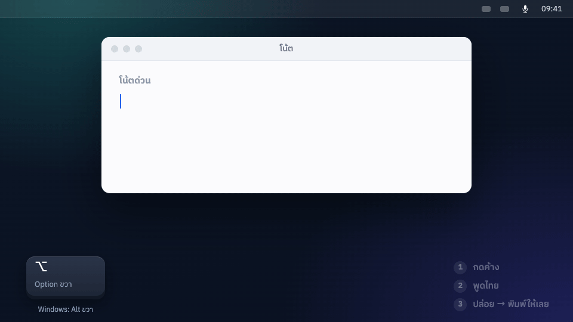

<p align="center">
  
</p>

<h1 align="center">PoodPim · พูดพิมพ์</h1>

<p align="center">
  <b>Hold a key, speak Thai, let go: the text is typed wherever your cursor is, in any app.</b><br>
  Or tap it once and keep talking: each part is typed as you go.<br>
  macOS · Windows · speech recognition on your own computer · free and open source
</p>

<p align="center">
  <a href="README.th.md">ภาษาไทย</a> · <b>English</b>
</p>

<p align="center">
  <a href="https://github.com/thirawat/PoodPim/releases/latest"></a>
  
  <a href="https://openthai.ai/openthai2p0-asr-streaming?ref=powered-by"></a>
</p>

<p align="center">
  
</p>

Hold a key, speak Thai (or Thai mixed with English), let go, and the text is typed where
your cursor is. Speech recognition runs locally on the CPU with
[iapp/OpenThai2.0-ASR-Streaming-ONNX](https://huggingface.co/iapp/OpenThai2.0-ASR-Streaming-ONNX)
(640M-parameter FastConformer + RNN-T, int8 encoder and decoder), or on your own AWS Lambda.

Written in Rust: one ~22 MB binary, ONNX Runtime linked in statically.

## Install

**macOS** (Apple silicon, macOS 13.4 or later), in Terminal:

```sh
curl -fsSL https://raw.githubusercontent.com/thirawat/PoodPim/main/install.sh | sh
```

**Windows** (10 / 11, 64-bit), in PowerShell:

```powershell
irm https://raw.githubusercontent.com/thirawat/PoodPim/main/install.ps1 | iex
```

The installer downloads the latest release, checks its SHA-256 (and on macOS that the app
carries the PoodPim signature), installs it (`/Applications`, or
`%LOCALAPPDATA%\Programs\PoodPim` with a Start menu shortcut; on Windows it also installs the
Microsoft Visual C++ Runtime if the PC lacks it, after Windows asks for permission) and opens it; the app then
offers to download the speech model (1 GB). Run it again to update. A release candidate:
put `POODPIM_VERSION=v1.0.1-rc.1` in front of `sh` (macOS) or set `$env:POODPIM_VERSION`
first (Windows).

Files fetched this way aren't quarantined, so macOS doesn't ask to "Open Anyway" and
Windows SmartScreen doesn't stop the unsigned exe. The zips on the
[releases page](https://github.com/thirawat/PoodPim/releases) work too, with those prompts.

**Updates:** the app checks GitHub once a day and asks before updating (Settings → Check for
updates…). A release candidate also picks up newer release candidates.
**Uninstall:** Settings → Uninstall… (asks whether to keep the downloaded model), or
`curl -fsSL https://raw.githubusercontent.com/thirawat/PoodPim/main/uninstall.sh | sh`;
on Windows also Settings › Apps › PoodPim.

## Use

| | macOS | Windows |
|---|---|---|
| Talk | hold **Right ⌥** | hold **Right Alt** |
| Hands-free, typed as you speak | tap Right ⌥, tap again to finish | tap Right Alt, tap again |
| Cancel | Esc (not passed on to the app you're in) | Esc |
| Paste | ⌘V (clipboard restored after) | Ctrl+V (clipboard restored after) |

The menu-bar / tray icon shows the state (mic = ready, red = listening, amber = transcribing).
If the microphone stops sending sound mid-recording (unplugged, a Bluetooth headset dropping:
nothing for 2 s, or 5 s from the start), the recording ends, what was heard is typed, and the
pill says so. If the talk key's release never arrives (macOS Secure Input, e.g. in a password
field), the app notices the key is up after a second and finishes as if it had been let go.
Dictating into a password field works, but while macOS Secure Input is on the pill doesn't
show the words, and the text isn't kept for "Paste last transcript" or Recent.
Its menu keeps the everyday actions: paste last transcript, **Recent** (the last 10
transcripts, kept in memory only, each with Paste and "Fix a word…", which opens "Add
correction…" filled with that transcript), Add correction…, and **Settings…**. "Open
Accessibility settings…" and "Download model" appear only while needed.

**Settings…** opens a window ([assets/settings.html](assets/settings.html) in the system
webview: WKWebView on macOS, WebView2 on Windows, built into Windows 11 and installed with
Edge on Windows 10; without it the app offers Microsoft's download page) with: Local /
Serverless backend with the server URL and API key, Thai + English vs Thai-only, numbers as
digits, the vocabulary and corrections files (with their counts and an inline "add
correction"), restore clipboard, free memory when idle, start at login, updates, the log
folder, and uninstall. On macOS the app gets a Dock icon and an Edit menu (⌘C / ⌘V in the
fields) only while the window is open.

**Typing while you speak (hands-free):** tap the talk key once and keep talking. Each time
you pause for about half a second (after at least 3 s of speech) the part you've finished is
typed straight away, instead of all of it when you tap again. Switch to another window
meanwhile and typing stops; the rest is put on the clipboard at the end for you to paste. Esc
stops listening but leaves what was already typed. The clipboard is saved before the first
part and put back after the last. Hold-to-talk still types everything on release. Off in
Settings → Typing while you speak.

**Seeing the words while you speak:** with the local model, the pill shows the end of what it
has heard so far, updated about every 1.2 s while you speak (not in silence): the unfinished part
is transcribed again in the background (only its last 6 s, ~250 ms on an M3), only while the
model has nothing else to do, so typing is never held up. On a slower PC it updates less often.
It costs about a third of a CPU core while you speak (measured on an M3: 53 s of speech took
~31 CPU-seconds with it, ~15 without). Off in Settings → Show words in the pill.

Numbers said in words become digits ("สองร้อยห้าสิบ" → 250, "สามจุดสอง" → 3.2,
"ห้าสิบเปอร์เซ็นต์" → 50%), carefully: a lone number word only after a word that asks for a
number (ข้อ, เวอร์ชัน, ครั้งที่…) or a Latin word, digits said one by one only from six (or
from three starting with ศูนย์), and words like สามารถ, ห้าม, เรียบร้อย are protected
([src/numbers.rs](src/numbers.rs)). Run over 5,583 lines of human-written Thai subtitles it
changed no ordinary word. Numbers and Latin words get spaces around them in Thai text.

Thai marks the end of a clause with a space rather than punctuation, and the model writes
none, so a pause between two Thai words becomes a space (not before an ending particle such
as ครับ or นะ: "ยังไง นะครับ" reads wrong). A pause needs both: the model waited 0.64 s or more
between the two pieces (the decoder keeps the frame each piece was emitted on), and the audio
in between has 0.5 s or more of silence (a long wait alone is sometimes the model emitting
late). Subtitle spaces follow line wraps, sometimes mid-word, so they could not be used to
tune it; by eye on the BA clips, 0.3 s of silence also spaced thinking pauses inside phrases,
0.5 s kept mostly clause breaks. `POODPIM_PAUSE_FRAMES` (80 ms each, 0 = off) and
`POODPIM_PAUSE_MS` override them for testing.

With "Restore clipboard" on (the default), the transcript is marked so clipboard managers
(Maccy, Paste, Windows clipboard history) skip it, and the previous clipboard is put back
only if nothing else was copied meanwhile. On macOS every type on the clipboard is kept
(copied files, rich text, HTML), not only plain text and images. On Windows, when the focused
app runs as administrator (Windows drops PoodPim's Ctrl+V there), the text is put on the
clipboard for you to paste, and the overlay says so.

"Free memory when idle" (off by default) frees the local model (~0.75 GB) after 15 minutes
without dictation. The next press of the talk key records at once and loads the model
while you speak (about 1–3 s), so only a short sentence waits a little longer.

The model download (~1 GB, from a fixed revision of the Hugging Face repo) carries on where it
stopped after a dropped connection or a restart of the app, and each file is checked
against its SHA-256 before use.

## Backends

| | Local | Serverless (AWS Lambda) |
|---|---|---|
| Where | this computer (int8 model, ~1 GB RAM) | Lambda in ap-southeast-7 (int8 model) |
| 6 s sentence | ~0.3 s | ~0.9 s warm · first use after ~10 min idle: +13 s cold start |
| Needs | model download (1 GB) | internet, server URL + API key |
| Audio leaves the machine | no | yes (HTTPS to your own AWS account) |

In serverless mode the app wakes the Lambda as soon as the talk key goes down, so most
of a cold start happens while you speak.

### Long dictation

While you talk, the recording is cut at pauses into segments of at most ~25 s
([src/segment.rs](src/segment.rs)), and each finished segment is transcribed in the
background, one at a time, in order ([src/pipeline.rs](src/pipeline.rs)). So:

- releasing the key only waits for the last segment, however long you spoke;
- no request comes near Lambda's 6 MB payload limit (≈ 2 min 20 s of audio in one
  request) or API Gateway's 30 s timeout — a single 4-minute request is rejected with 413;
- long silent pauses never sit inside one decode (the model can drop words after them).

One recording is capped at 10 minutes (it then finishes on its own). Text is pasted once,
at the end. Measured on a 4 min 17 s file: 20 segments, same accuracy as decoding it
whole (CER 9.3% vs 10.0% against the script, mostly digits/English spellings). Setup and costs: [deploy/lambda/README.md](deploy/lambda/README.md).

## Model

The int8 build (~1 GB), downloaded once from the menu or with `poodpim download`, into
`$POODPIM_MODEL_DIR` or the per-user data folder:

- macOS: `~/Library/Application Support/poodpim/openthai-asr`
- Windows: `%APPDATA%\poodpim\openthai-asr`

Versions before 1.0.2 downloaded the fp32 encoder (2.6 GB of RAM). The app offers once to
replace it with int8 and deletes the fp32 files after the int8 model has loaded. On
[tools/asr-eval](tools/asr-eval/eval.py) (60 clips of fast Thai/English tech talk) int8 was
as accurate (CER 26.0% vs 25.5%, within noise) with 0.99 GB instead of 2.64 GB of RAM and a
2.3× faster encoder.

The decoder is int8 too: `decoder_joint.int8.onnx` (27 MB instead of 102 MB) comes from this
repo's [model-decoder-int8-1](https://github.com/thirawat/PoodPim/releases/tag/model-decoder-int8-1)
release, made with [tools/quantize-decoder.py](tools/quantize-decoder.py). A model downloaded
before it existed gets it in the background, and the app loads it once you're not dictating;
without it the fp32 decoder is used. On tools/asr-eval with the bundled vocabulary it was as
accurate (CER 24.0 vs 23.9% on the tech set, 26.0 vs 26.0% on the BA set; English words found
63.0 vs 63.7% and 50.0 vs 48.8%), and the beam search spends 2.7× less time in the decoder:
a whole run of the tech set took 31 s instead of 52 s.

## Vocabulary (English terms)

The model hears many English words in Thai speech but spells them by ear ("จีพียู",
"เอ็นเดีย"). Two things help, both in Thai + English mode:

- **Hotwords.** Words in the user's vocabulary file (Settings → My vocabulary; created from
  [assets/vocabulary.txt](assets/vocabulary.txt), ~340 tech terms and words Thai developers say in English) are favoured while
  decoding: beam search (6 hypotheses, batched into one decoder call per step, up to 3 pieces
  per 80 ms frame) over a character trie of the terms, so any way the model splits a word into
  pieces matches, with a bonus per matching piece that is taken back if the match fails.
  The list is reloaded when the file changes, and sent to the serverless backend in the
  `x-poodpim-vocabulary` header. An empty list means plain greedy decoding.
- **Acronyms.** Tech acronyms spelled in Thai are written in Latin ("จีพียู" → "GPU").
- **Word corrections.** Words the model keeps hearing the same wrong way, or Thai spellings
  someone wants in English, are replaced after decoding (Settings → corrections; lines
  `heard, heard = wanted`; started from [assets/corrections.txt](assets/corrections.txt),
  dev terms such as "เดฟออฟ, depop = DevOps"). Applied in the app, so it works with either
  backend; longest match first; Latin words match whole words only; a Latin replacement
  next to Thai letters gets a space.

Both files start from the defaults, and a copy of the default is kept beside each
(`*.txt.orig`): while a file is unedited it follows newer defaults, once edited it is left
alone.

On tools/asr-eval, against greedy fp32: CER 23.4% vs 25.5%, English words of the subtitles
found 59% vs 39%; decoding took 1.8× as long, but with the int8 encoder the whole run used
31% less CPU time. Short words that sound like Thai ones (LINE ~ "ไลน์") cause false matches,
so the default list leaves them out (also "Facebook", which turned "เฟส", phase, into
Facebook). Slowing the audio down before decoding did not help.

A second set, `POODPIM_EVAL_SET=ba` (36 clips of project-management and Agile talks by
three speakers), has subtitles that are partly machine-made, so its CER is only good for
comparing conditions: there the default list raises English words found from 33% to 49%
and CER falls from 28.1% to 26.2%.

## Build

```sh
cargo build --release            # target/release/poodpim (desktop)
cargo build --release --no-default-features --features lambda --bin poodpim-lambda   # Lambda (see deploy/)
./scripts/bundle-macos.sh        # dist/PoodPim.app (menu-bar app, signed with a local certificate)
./scripts/package-macos.sh       # dist/PoodPim-<version>-mac.zip to give to other people
./scripts/package-windows.sh     # dist/PoodPim-<version>-windows.zip, cross-compiled on the Mac
```

### Sharing the app

`package-macos.sh` builds a zip with PoodPim.app and a Thai install guide
([scripts/share/install-th.txt](scripts/share/install-th.txt)). The app carries
`Contents/Resources/preset.json` (local backend, no server URL or API key), which
becomes the recipient's config on first launch, so the app offers to download the model
right away. The zips may be published, so to share a serverless backend give people the API
URL and key separately (everyone shares one key; Settings → Serverless); the app
asks for the key again if the server rejects it. To cut access, rotate the key
([deploy/lambda/README.md](deploy/lambda/README.md)) and send people the new one.

The app starts at login by default (Settings → start at login; a LaunchAgent in
`~/Library/LaunchAgents/local.poodpim.app.plist` on macOS, the `HKCU\…\Run` registry key on
Windows), pointing at wherever it was last started from.

In Local mode without a downloaded model, starting the app, choosing Local or pressing the
talk key offers to download it (1 GB).
The app is not notarized, so recipients open it once via System Settings › Privacy &
Security › Open Anyway. Apple-silicon Macs only (arm64 build).

Windows: `package-windows.sh` cross-compiles from macOS with
[cargo-xwin](https://github.com/rust-cross/cargo-xwin) (`cargo install --locked cargo-xwin`;
MSVC/SDK libraries are cached in `target/xwin-cache`), or build on Windows with the MSVC
toolchain (`cargo build --release`). The zip ships `DirectML.dll` next to the exe (the prebuilt
ONNX Runtime for Windows always links it) and needs the Visual C++ runtime on the PC
(install.ps1 installs Microsoft's `vc_redist.x64.exe`, after checking its signature, unless
`msvcp140.dll`, `vcruntime140.dll` and `vcruntime140_1.dll` are in System32 (on ARM64: the x64
runtime is registered) or PoodPim was running before the update; it doesn't start the app while
the runtime is missing).

On Windows, PoodPim takes Right Alt for itself: other apps never see it, because an Alt
pressed and released on its own opens the focused app's menu (Office KeyTips). Left Alt is
unaffected; on keyboard layouts that type with AltGr (Right Alt), AltGr is unavailable while
PoodPim runs. The Windows build shows the same bottom-of-screen overlay as macOS (a GDI tool window) and asks
for the server URL / API key with InputBox dialogs. Its log is
`%LOCALAPPDATA%\poodpim\logs\poodpim.log` (macOS: `~/Library/Logs/PoodPim/poodpim.log`); it
records timings and errors, not what was said.

### macOS permissions

Grant to **PoodPim.app** (or to your terminal when running `target/release/poodpim`):

- **Microphone** — asked on first recording.
- **Accessibility** — System Settings › Privacy & Security › Accessibility. Needed to
  see the talk key in other apps and to send ⌘V. Until it is granted, the menu's top line
  says so and "Open Accessibility settings…" opens the right page. The app is signed with
  a fixed local certificate (see `bundle-macos.sh`), so the permission survives rebuilds.

## CLI

```sh
poodpim                                # tray / menu-bar app
poodpim transcribe a.wav b.wav [--thai-only] [--server] [--live] [--whole]
poodpim download [--check]
poodpim backend local|lambda
echo "$API_KEY" | poodpim server https://<api-id>.execute-api.ap-southeast-7.amazonaws.com
poodpim config                         # show settings (key hidden)
```

`POODPIM_TIMING=1` prints mel / encoder / decoder timings.

## How it works

```
talk key (CGEventTap / WH_KEYBOARD_LL) → cpal mic capture → resample to 16 kHz → trim silence
  → log-mel (128 bands, NeMo settings) → encoder.onnx → greedy RNN-T over decoder_joint.onnx
  → clipboard + ⌘V / Ctrl+V → restore previous clipboard
```

- [src/features.rs](src/features.rs) — log-mel features (Slaney mel filters, matches librosa).
- [src/asr.rs](src/asr.rs) — ONNX sessions, warm-up, greedy decoding. Sessions are pinned to the
  CPU: ort's default device policy sends the model to CoreML on macOS, which is ~2× slower here.
- [src/audio.rs](src/audio.rs) — microphone, resampler, silence trim, WAV loading.
- [src/platform/](src/platform/) — talk key + paste keystroke per OS.
- [src/app.rs](src/app.rs) — tray app, recording state machine, local/serverless switch.
- [src/segment.rs](src/segment.rs), [src/pipeline.rs](src/pipeline.rs) — cut at pauses, transcribe while recording.
- [src/remote.rs](src/remote.rs) — client for the serverless backend.
- [src/bin/poodpim-lambda.rs](src/bin/poodpim-lambda.rs) — Lambda handler (`--features lambda`).

The overall design (global hotkey → recorder with silence trim → local ASR → ⌘V insertion
that borrows the clipboard) follows what REA found when inspecting Spokenly.app. No
Spokenly code or assets are used.

## Licences

PoodPim (this code, the logo and the demo): [MIT](LICENSE).

The speech model is not part of this repository: the app downloads
OpenThai2.0-ASR-Streaming from Hugging Face, under its own licence, OpenMDW-1.1 (see
`LICENSE` in the model folder).

The logo and demo are drawn from [assets/logo.svg](assets/logo.svg) and
[assets/demo/scene.html](assets/demo/scene.html): `scripts/make-icons.sh` rebuilds the app
icons, `scripts/make-demo.sh` the demo GIF.
