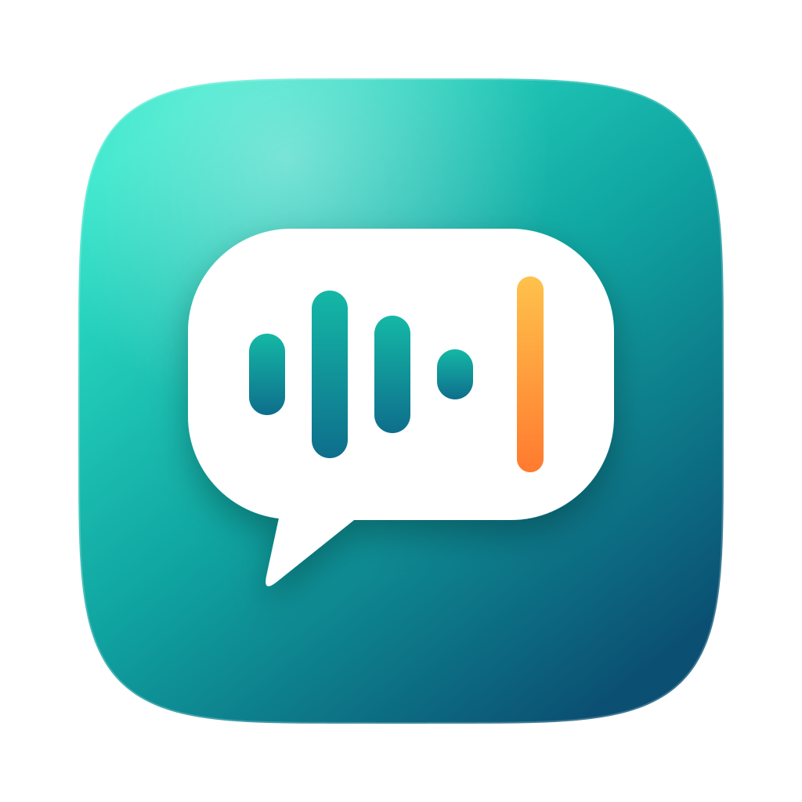
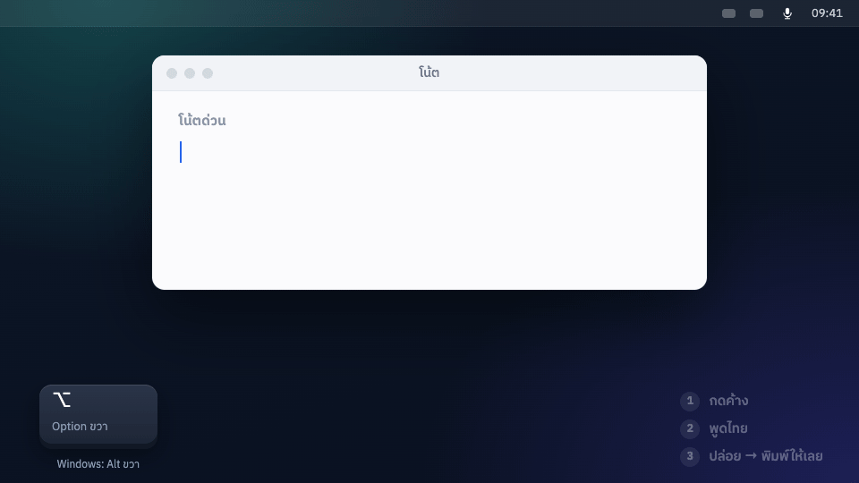

<p align="center">
  
</p>

<h1 align="center">PoodPim · พูดพิมพ์</h1>

<p align="center">
  <b>กดปุ่มค้าง พูดภาษาไทย แล้วปล่อย ข้อความจะถูกพิมพ์ลงตรงที่เคอร์เซอร์อยู่ ใช้ได้ทุกแอป</b><br>
  macOS · Windows · ถอดเสียงในเครื่องของคุณเอง · ฟรีและโอเพนซอร์ส
</p>

<p align="center">
  <b>ภาษาไทย</b> · <a href="README.md">English</a>
</p>

<p align="center">
  <a href="https://github.com/thirawat/PoodPim/releases/latest"></a>
  
  <a href="https://openthai.ai/openthai2p0-asr-streaming?ref=powered-by"></a>
</p>

<p align="center">
  
</p>

## ทำอะไรได้

- **พิมพ์ด้วยเสียงได้ทุกแอป:** LINE, Word, Chrome, อีเมล, ช่องค้นหา ข้อความไปลงตรงที่เคอร์เซอร์อยู่
- **ถอดเสียงในเครื่อง:** ไม่ต้องต่อเน็ต เสียงไม่ถูกส่งออกไปไหน ประโยคยาว 6 วินาทีถอดเสร็จในราว 0.45 วินาที (MacBook M3)
- **พูดยาวได้ถึง 10 นาทีต่อครั้ง:** แอปตัดเสียงตามจังหวะที่หยุดพูด แล้วถอดไประหว่างที่ยังพูดอยู่ ปล่อยปุ่มแล้วรอแค่ราว 1–2 วินาที
- **ไทยปนอังกฤษ:** พูดไทยปนอังกฤษได้ และใส่ "คำศัพท์ของฉัน" ได้ เช่น ชื่อบริษัท ชื่อสินค้า ศัพท์ในงาน ให้ออกมาเป็นตัวอังกฤษถูกต้องบ่อยขึ้น (ทดสอบกับคลิปพูดเร็วปนศัพท์เทค: คำอังกฤษถูกเพิ่มจาก 39% เป็น 59%)
- **ใช้กันทั้งทีมได้:** ตั้งเซิร์ฟเวอร์ถอดเสียงบน AWS ของทีมเองได้ด้วยคำสั่งเดียว เครื่องที่ RAM น้อยก็ใช้ได้
- **ติดตั้ง อัปเดต และถอนการติดตั้งได้ง่าย:** ติดตั้งด้วยคำสั่งเดียว แอปเช็คเวอร์ชันใหม่เองและถามก่อนอัปเดตทุกครั้ง

## ติดตั้ง

**macOS** (Mac ชิป Apple M1 ขึ้นไป, macOS 13.4 ขึ้นไป) เปิดแอป **Terminal** (กด ⌘ Space พิมพ์ Terminal) แล้ววาง:

```sh
curl -fsSL https://raw.githubusercontent.com/thirawat/PoodPim/main/install.sh | sh
```

**Windows 10 / 11** (64-bit) เปิด **PowerShell** (กดปุ่ม Windows พิมพ์ PowerShell) แล้ววาง:

```powershell
irm https://raw.githubusercontent.com/thirawat/PoodPim/main/install.ps1 | iex
```

คำสั่งนี้จะดาวน์โหลด PoodPim เวอร์ชันล่าสุด ตรวจว่าไฟล์ไม่เสียหาย ติดตั้ง และเปิดแอปให้เอง
- ไม่ต้องลากแอปเอง และไม่ต้องกด "Open Anyway"
- บน Windows จะมีทางลัดใน Start menu ให้ด้วย
- เปิดแอปครั้งแรก แอปจะถามให้ดาวน์โหลดโมเดลถอดเสียง (1 GB ครั้งเดียว)

ถ้าไม่สะดวกใช้คำสั่ง ดาวน์โหลดไฟล์ zip จาก[หน้า releases](https://github.com/thirawat/PoodPim/releases/latest) แล้วทำตามไฟล์ `README-TH.txt` ในนั้น

**สิทธิ์ที่ต้องให้บน macOS:** แอปจะขอสิทธิ์เองตอนเปิดครั้งแรก
- **ไมโครโฟน:** ใช้ฟังเสียงพูด
- **Accessibility:** ใช้รู้ว่ากดปุ่มพูด และวางข้อความลงแอปที่ใช้อยู่ เปิดที่ System Settings › Privacy & Security › Accessibility

## วิธีใช้

| | macOS | Windows |
|---|---|---|
| พูด | กด **Option ขวา** ค้างไว้ พูด แล้วปล่อย | กด **Alt ขวา** ค้างไว้ พูด แล้วปล่อย |
| พูดยาวโดยไม่ต้องกดค้าง | แตะ Option ขวา 1 ครั้ง พูด แล้วแตะอีกครั้งเมื่อจบ | แตะ Alt ขวา 1 ครั้ง พูด แล้วแตะอีกครั้ง |
| ยกเลิก | Esc | Esc |
| พิมพ์ข้อความล่าสุดซ้ำ | เมนู 🎙 › Paste last transcript | เมนูไอคอนไมโครโฟน › Paste last transcript |

- **แถบลอยกลางจอด้านล่าง:** บอกสถานะตลอด คือกำลังฟัง (แดง) → กำลังถอดเสียง (ส้ม) → พิมพ์แล้ว (เขียว) ตอนเปิดแอปจะขึ้นว่า "PoodPim พร้อมแล้ว"
- **วางข้อความด้วย ⌘V / Ctrl+V:** แอปคืนข้อความเดิมใน clipboard ให้หลังวางเสร็จ
  - บน Mac คืนได้ทุกแบบ รวมถึงไฟล์ที่ก๊อปจาก Finder และข้อความที่มีรูปแบบ
  - ถ้าระหว่างนั้นคุณก๊อปอย่างอื่นใหม่ แอปจะไม่ทับของใหม่
  - ข้อความที่พูดจะไม่ไปค้างในประวัติ clipboard (Maccy, Paste, Win+V)
- **Windows:** ระหว่างที่ PoodPim เปิดอยู่ Alt ขวาเป็นปุ่มพูดอย่างเดียว เมนูของโปรแกรมอื่นจึงไม่เด้งขึ้นมา ส่วน Alt ซ้ายใช้ได้ตามปกติ

## ถอดในเครื่อง หรือใช้เซิร์ฟเวอร์ของทีม

เลือกได้ที่เมนูของแอป ค่าเริ่มต้นคือถอดในเครื่อง

| | ถอดในเครื่อง (Local) | เซิร์ฟเวอร์ของทีม (Serverless) |
|---|---|---|
| ถอดที่ไหน | เครื่องนี้ | AWS Lambda ในบัญชี AWS ของทีมคุณเอง (กรุงเทพฯ) |
| ประโยค 6 วินาที | ~0.45 วินาที | ~0.9 วินาที (ครั้งแรกหลังไม่ได้ใช้นานเกิน ~10 นาที รอเพิ่มราว 14 วินาที) |
| ต้องมี | โมเดล 1 GB และ RAM ราว 1 GB | อินเทอร์เน็ต, API URL และ API key จากคนดูแลเซิร์ฟเวอร์ |
| เสียงออกนอกเครื่อง | ไม่ | ใช่ (HTTPS ไปที่บัญชี AWS ของทีม) |
| ค่าใช้จ่าย | ฟรี | ค่า AWS หลักสิบบาทต่อคนต่อเดือนแล้วแต่การใช้งาน |

- **เครื่อง RAM 8 GB ขึ้นไป:** ถอดในเครื่องได้สบาย
- **อยากคืน RAM ตอนไม่ได้ใช้:** เปิดเมนู "Free memory when idle (15 min)" ถ้าไม่ได้พูด 15 นาที แอปจะคืน RAM ราว 0.75 GB พอกดพูดครั้งถัดไปก็เริ่มอัดเลย แอปโหลดโมเดลระหว่างที่คุณพูด (1–3 วินาที)
- **ดาวน์โหลดโมเดลแล้วเน็ตหลุด:** กดดาวน์โหลดอีกครั้ง แอปจะโหลดต่อจากที่ค้างไว้ และตรวจว่าไฟล์ครบถูกต้องก่อนใช้
- **เคยใช้เวอร์ชันก่อน 1.0.2:** แอปจะถามครั้งเดียวว่าจะเปลี่ยนเป็นโมเดลรุ่นเล็ก (ใช้ RAM 1 GB แทน 2.6 GB แม่นเท่าเดิม) ถ้าเปลี่ยน แอปจะลบรุ่นเดิมให้ คืนพื้นที่ 2.4 GB
- **ตั้งเซิร์ฟเวอร์ของทีม:** ดูที่ [deploy/lambda/README.md](deploy/lambda/README.md) สั่งคำสั่งเดียวแล้วได้ URL กับ key ไปแจกในทีม

## คำศัพท์ของฉัน

โมเดลมักได้ยินคำอังกฤษในประโยคไทย แต่สะกดตามเสียง เช่น "จีพียู", "เอ็นเดีย" เมนู › **My vocabulary…** จะเปิดไฟล์รายการคำขึ้นมาให้แก้ (TextEdit / Notepad)

- แอปใส่ศัพท์เทคไว้ให้ราว 340 คำ เช่น ChatGPT, Nvidia, Kubernetes, machine learning เพิ่มหรือลบได้เลย หนึ่งคำต่อบรรทัด
- ใส่คำที่คุณหรือทีมพูดบ่อย เช่น ชื่อบริษัท ชื่อสินค้า ชื่อโปรเจกต์ เขียนแบบที่อยากให้ออกมา (ตัวพิมพ์เล็ก-ใหญ่ตามนี้)
- บันทึกไฟล์แล้วใช้ได้ทันที ไม่ต้องเปิดแอปใหม่
- ไม่ควรใส่คำสั้นที่เสียงพ้องกับคำไทย (เช่น LINE ที่เสียงคล้าย "ไลน์") แอปอาจใส่คำนั้นในที่ที่คุณไม่ได้พูด
- ใช้กับโหมด Thai + English ทั้งถอดในเครื่องและเซิร์ฟเวอร์ของทีม (เซิร์ฟเวอร์ต้องเป็นเวอร์ชัน 1.0.2 ขึ้นไป)
- ตัวย่อที่สะกดเป็นไทยจะถูกเขียนเป็นตัวอังกฤษให้อัตโนมัติ เช่น "จีพียู" → "GPU"

## แก้คำ

คำที่โมเดลได้ยินผิดแบบเดิมซ้ำๆ หรือคำทับศัพท์ที่อยากให้เขียนเป็นอังกฤษ ใส่ไว้ในเมนู › **Word corrections…** แอปจะแทนให้หลังถอดเสียงทุกครั้ง

```
เดฟออฟ, depop = DevOps
อินฟา = infra
เซิร์ฟเวอร์ = server
```

- บรรทัดละคู่: `คำที่ได้ = คำที่อยากได้` ถ้าได้ยินผิดหลายแบบ คั่นด้วย `,`
- แอปใส่คำสายพัฒนาซอฟต์แวร์ไว้ให้ราว 35 คู่ ไม่อยากให้แก้คำไหน ลบบรรทัดนั้นทิ้งได้
- ใช้ได้ทั้งถอดในเครื่องและเซิร์ฟเวอร์ของทีม บันทึกไฟล์แล้วใช้ได้ทันที
- คำไทยไม่มีช่องว่างระหว่างคำ จึงถูกแทนทุกที่ที่เจอ ควรเลือกคำที่ไม่ไปซ้ำกับส่วนหนึ่งของคำไทยอื่น (เช่น "แคช" อยู่ใน "แคชเชียร์")
- ถ้าคำอังกฤษไปติดกับตัวอักษรไทย แอปเว้นวรรคให้ ("ใช้ GPU กับ CPU")
- ใช้ร่วมกับ "คำศัพท์ของฉัน" ได้ดี: คำศัพท์ช่วยตอนโมเดลลังเล ส่วนแก้คำใช้กับคำที่โมเดลได้ยินผิดแบบเดิมเป็นประจำ
- ถ้าไม่เคยแก้ไฟล์คำศัพท์หรือไฟล์แก้คำ แอปเวอร์ชันใหม่จะอัปเดตรายการให้เอง ถ้าแก้แล้วจะไม่ไปแตะ

## อัปเดตและถอนการติดตั้ง

- **อัปเดต:** แอปเช็คเวอร์ชันใหม่วันละครั้ง และถามก่อนอัปเดตทุกครั้ง เช็คเองได้ที่เมนู › Check for updates…
- **ถอนการติดตั้ง:** เมนู › Uninstall PoodPim… แอปจะถามว่าจะเก็บโมเดลไว้ไหม เก็บไว้แล้วติดตั้งใหม่จะไม่ต้องดาวน์โหลดซ้ำ
  - Windows: ถอนจาก Settings › Apps › PoodPim ได้ด้วย
  - ผ่าน Terminal: `curl -fsSL https://raw.githubusercontent.com/thirawat/PoodPim/main/uninstall.sh | sh`

## แก้ปัญหา

**เปิดแอปแล้วไม่เห็นไอคอนบนแถบเมนู (Mac)**
- MacBook ที่จอมีรอยบากจะซ่อนไอคอนที่ล้นแถบเมนูไว้หลังรอยบาก ไอคอนที่เพิ่งเปิดใหม่จะถูกซ่อนก่อน
- **แก้:** กด ⌘ ค้างแล้วลากไอคอนอื่นที่ไม่ได้ใช้ออกจากแถบเมนู หรือดูที่ System Settings › Menu Bar
- **เช็คว่าแอปทำงานอยู่ไหม:** เปิด PoodPim อีกครั้ง ถ้าทำงานอยู่จะมีหน้าต่างบอกว่า "PoodPim เปิดอยู่แล้ว"

**กดปุ่มแล้วไม่มีอะไรเกิดขึ้น**
- คลิกไอคอนไมโครโฟน แล้วดูบรรทัดบนสุดของเมนู
  - ถ้าขึ้นว่าต้องให้สิทธิ์ Accessibility (Mac) ให้กด "Open Accessibility settings…" แล้วเปิดสวิตช์ของ PoodPim
  - ถ้าขึ้นว่า "Model not downloaded" ให้กด Download model

**ข้อความไม่ถูกพิมพ์**
- คลิกในช่องพิมพ์ก่อนกดปุ่มพูด
- บน Windows โปรแกรมที่เปิดแบบ Run as administrator จะรับข้อความจาก PoodPim ไม่ได้ แอปจะคัดลอกข้อความไว้ให้ แล้วขึ้นบอกให้กด Ctrl+V เอง

**แจ้งปัญหา**
- เปิด [Issue](https://github.com/thirawat/PoodPim/issues) พร้อมแนบไฟล์ log ไฟล์นี้บันทึกแค่เวลาและ error ไม่มีข้อความที่พูด
  - Mac: `~/Library/Logs/PoodPim/poodpim.log`
  - Windows: `%LOCALAPPDATA%\poodpim\logs\poodpim.log`

## ความเป็นส่วนตัว

- **โหมดถอดในเครื่อง:** เสียงและข้อความอยู่ในเครื่องของคุณเท่านั้น
- **โหมดเซิร์ฟเวอร์ของทีม:** เสียงถูกส่งไปถอดที่บัญชี AWS ของทีม เซิร์ฟเวอร์ไม่ได้บันทึกเสียงหรือข้อความเก็บไว้
- **การอัปเดต:** แอปติดต่อ GitHub วันละครั้งเพื่อเช็คเวอร์ชันใหม่ ไม่ได้ส่งข้อมูลการใช้งาน

## สำหรับนักพัฒนา

- **Build จากโค้ด ใช้ผ่าน CLI และหลักการทำงาน:** ดูที่ [README ภาษาอังกฤษ](README.md#build)
- **ภาษาที่ใช้:** เขียนด้วย Rust ไฟล์โปรแกรมเดียวขนาดราว 22 MB ฝัง ONNX Runtime ไว้ข้างใน
- **โลโก้และภาพตัวอย่าง:** สร้างจาก [assets/logo.svg](assets/logo.svg) และ [assets/demo/scene.html](assets/demo/scene.html)

## ขอบคุณ

ถอดเสียงด้วยโมเดล [OpenThai2.0-ASR-Streaming](https://huggingface.co/iapp/OpenThai2.0-ASR-Streaming-ONNX)
ของ iApp Technology ในโครงการ OpenThai ที่เปิดให้ใช้ฟรี

## สัญญาอนุญาต

- **โค้ด โลโก้ และภาพตัวอย่างของ PoodPim:** [MIT](LICENSE) นำไปใช้ แก้ไข หรือแจกต่อได้ รวมถึงใช้เชิงพาณิชย์ ขอแค่คงข้อความลิขสิทธิ์ไว้
- **โมเดลถอดเสียง:** ไม่ได้อยู่ใน repo นี้ แอปดาวน์โหลดจาก Hugging Face และใช้สัญญาอนุญาตของโมเดลเอง คือ OpenMDW-1.1
